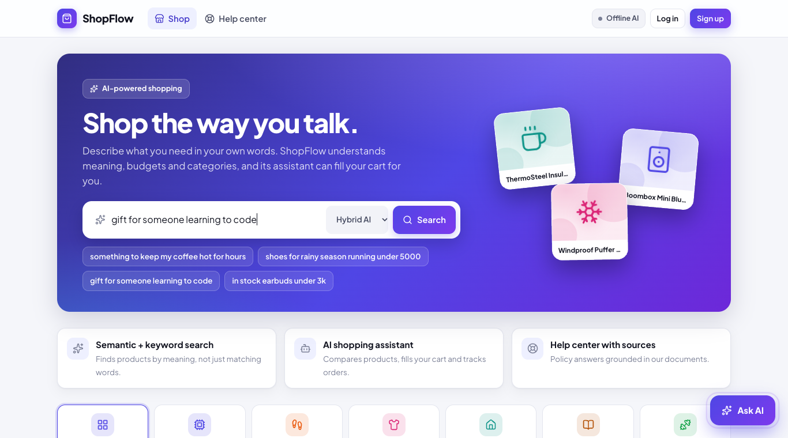
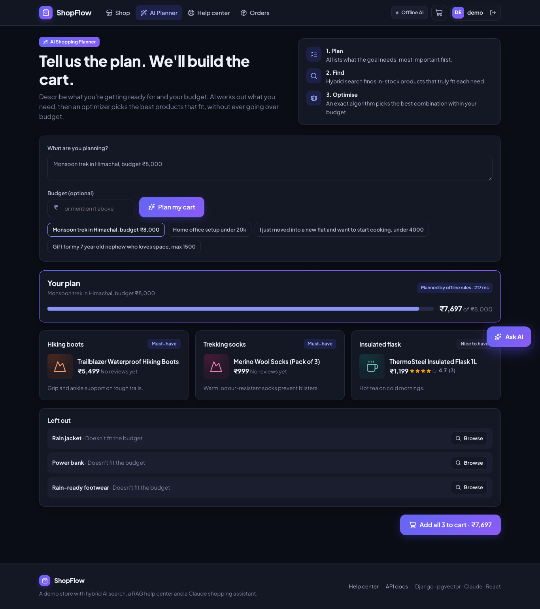
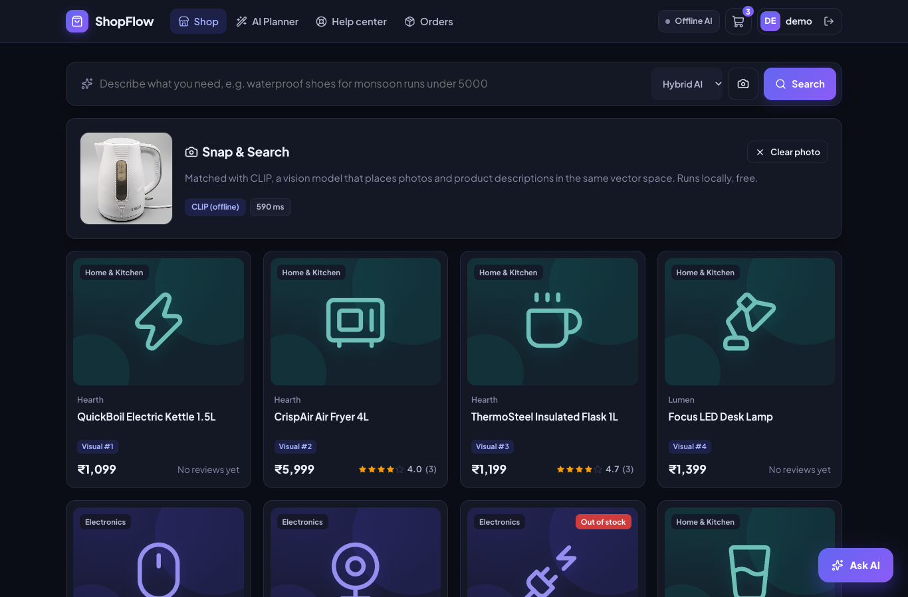
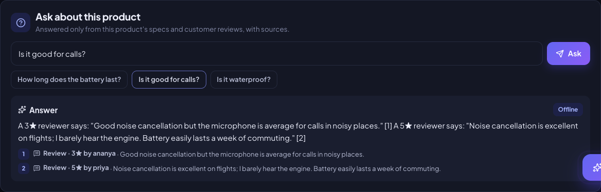
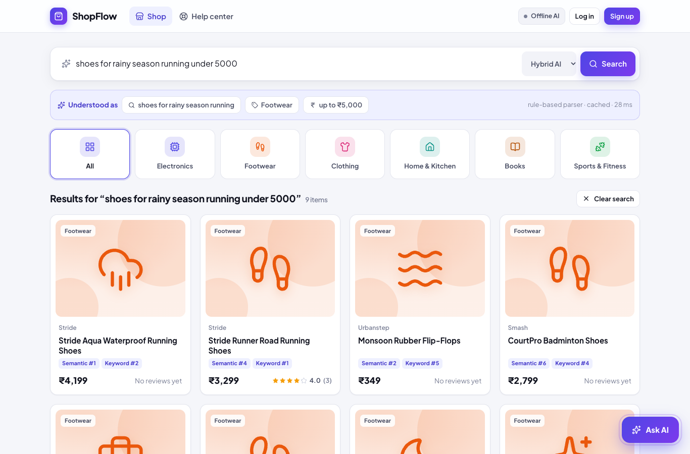
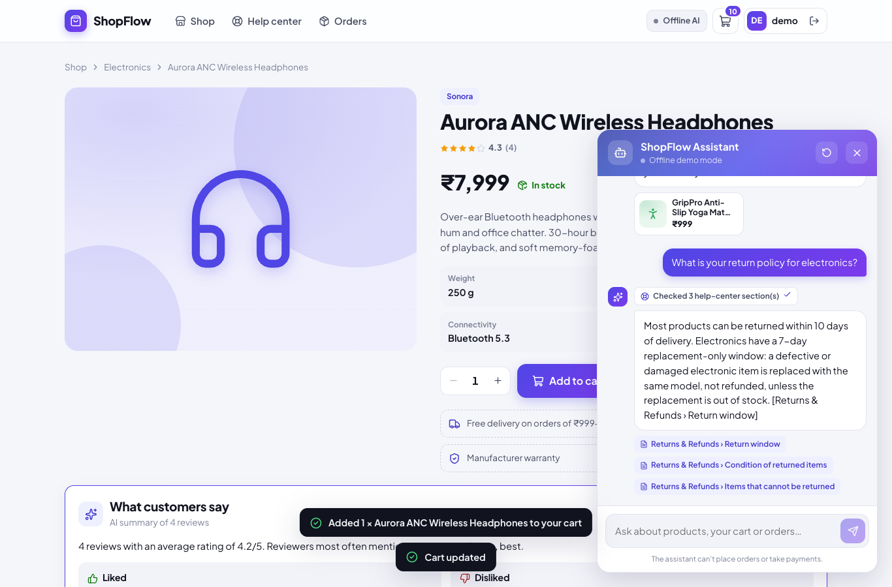
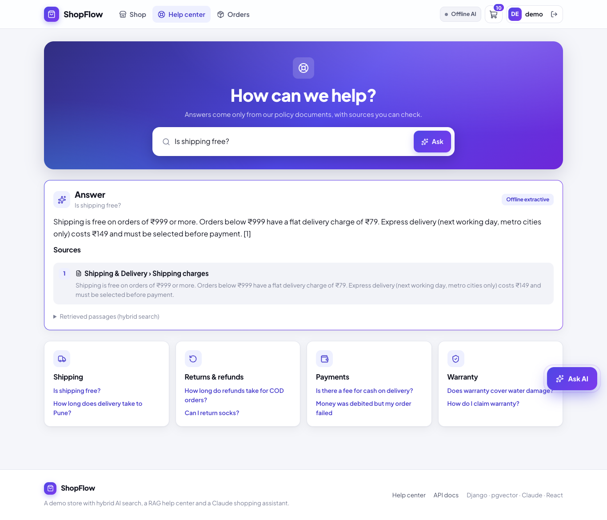
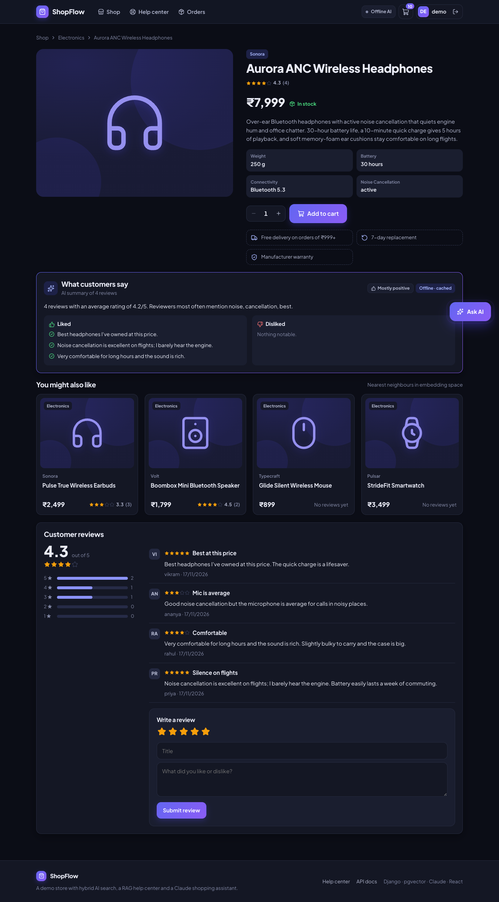
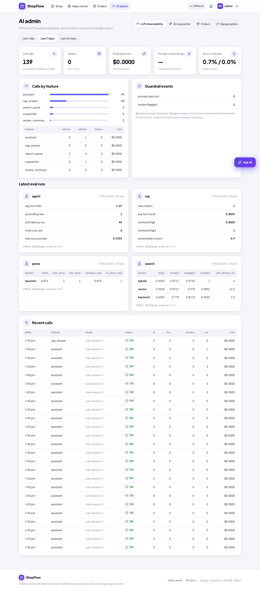
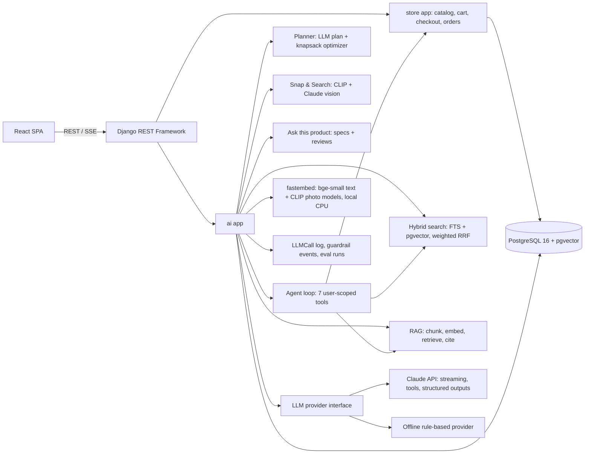

# ShopFlow

An e-commerce platform with a production-style GenAI layer: an **AI Shopping Planner** that turns a goal and a budget into an optimal cart, **photo search** with CLIP and Claude vision, **product Q&A** grounded in specs and reviews, hybrid semantic search over pgvector, a RAG help center and a tool-calling shopping assistant built on the Claude API. Guardrails, observability and an evaluation suite keep it all trustworthy.

**Stack:** Django 6 · Django REST Framework · PostgreSQL 16 + pgvector · Anthropic Claude API (`claude-opus-5-5`, text + vision) · fastembed (bge-small-en-v1.5, CLIP ViT-B/32) · React 19 + Vite · JWT · Docker Compose · GitHub Actions

It runs at no cost: embeddings are computed locally, and with no API key the LLM features use a clearly labelled offline mode. Set `ANTHROPIC_API_KEY` to use Claude. If the key is wrong, out of credits or Claude is down, the app falls back to offline mode automatically instead of breaking.



**Contents:** [What makes it different](#what-makes-it-different) · [Getting started](#getting-started) · [What's in it](#whats-in-it) · [Evaluation results](#evaluation-results) · [Architecture](#architecture) · [Tests and evals](#tests-and-evals) · [API overview](#api-overview) · [Project layout](#project-layout) · [Limitations](#limitations-and-next-steps)

## What makes it different

| Feature | What it does | How it works |
|---|---|---|
| **AI Shopping Planner** | "Monsoon trek in Himachal, budget ₹8,000" → a complete cart | The LLM plans the needs in order of importance (structured output). Hybrid search finds in-stock products that genuinely fit each need. An **exact multiple-choice knapsack optimizer** picks the best combination. The LLM plans; code enforces the budget, so the total can't go over. |
| **Snap & Search** | Upload a photo, find the product | **CLIP** places photos and product text in one vector space (pgvector, zero-shot, runs locally for free). With a key, **Claude vision** also describes the photo as a structured query, and the two rankings are fused with RRF. |
| **Ask this product** | "Is the mic good for calls?" on any product page | Retrieval over that product's spec lines, description sentences and reviews, with cited answers that keep facts ("the specs list…") apart from opinions ("reviewers say…"). Questions the data can't answer are declined. |
| **Complete the kit** | Running shoes → sports tee, smartwatch, foam roller | The planner is reused to suggest *complementary* items. Raw embedding similarity was tried first and rejected: similar is not the same as complementary (it suggested a monitor for a frying pan). |

| AI Shopping Planner | Snap & Search |
|---|---|
|  |  |



## What's in it

**E-commerce core**
- Product catalog, cart, checkout and order tracking (Pending → Shipped → Delivered, or Cancelled), with a full status history.
- Checkout runs in one database transaction with `SELECT … FOR UPDATE` row locks, so two customers cannot buy the last unit at the same time. Cancelling restores stock.
- JWT authentication and role-based permissions: customers and staff, with staff-only catalog writes and order status changes.
- Normalized PostgreSQL schema through the Django ORM, a Django admin for inventory and orders, and OpenAPI docs at `/api/docs/`.
- 44 REST endpoints (method + path, including a health check) across auth, catalog, cart, orders and AI.

**GenAI features**

| Feature | How it works |
|---|---|
| **Hybrid semantic search** | Product embeddings are stored in pgvector (HNSW, cosine distance) and combined with PostgreSQL full-text search using **weighted Reciprocal Rank Fusion**. Each result shows which retriever found it. |
| **Query understanding** | Claude **structured outputs** turn "waterproof shoes under 3k in stock" into validated filters (category, price range, stock). Model output is re-validated, and results are cached. |
| **Shopping assistant (agent)** | A Claude tool-use loop with **7 tools** (search, product details, add to cart, view cart, list orders, order status, policy search), streamed to the browser over **Server-Sent Events**. Conversations are persisted. |
| **RAG help center** | Policy documents are split into heading-aware chunks, retrieved with hybrid search, and answered with **numbered citations**. The model must say when the sources don't contain the answer. |
| **Review insights** | Structured summary, pros, cons and sentiment from customer reviews. It is cached and regenerated only when the reviews change. |
| **AI copywriter (staff)** | Generates a headline, description, highlights, tags and SEO text from product facts. Any number not found in the facts is flagged before publishing. |
| **Similar products** | Nearest neighbours in embedding space. |

**Making it trustworthy**
- **It never breaks for lack of Claude.** With no key, every AI feature runs in offline mode. With a key that fails (invalid, expired, no credits, network or API outage), each request falls back to offline mode and Claude is skipped for a 5-minute cool-down. The failed call is still logged as an error on the dashboard, and the UI shows "Claude unavailable · offline". This was tested against the real Anthropic API with an invalid key. Refusals are deliberately *not* masked by this fallback.
- **Agent security.** Tools run as the signed-in user taken from the request, never from model output, so the assistant cannot read another customer's orders. Tool inputs are validated with Pydantic. There is deliberately no checkout tool: payment stays with the human.
- **Guardrails.** Prompt-injection detection runs on user messages and on product reviews (indirect injection: reviews end up inside tool results, so flagged reviews never reach a prompt). Input limits, per-scope rate limits and a cap on tool rounds stop runaway agent loops.
- **Hallucination check.** Every price the assistant writes must appear in a tool result. Anything else is flagged in the UI and logged.
- **Observability.** Every LLM call is logged with tokens, prompt-cache hits, latency, estimated cost, refusals and fallback use. A staff dashboard shows totals, p50/p95 latency per feature, guardrail events and the latest eval results.
- **Claude API practices.** A static system prompt and tool list keep the prefix cacheable for prompt caching. History is append-only and replayed verbatim, thinking blocks included. `output_config.effort` is set per route. Server-side refusal fallbacks are enabled. `stop_reason` is checked (`refusal`, `max_tokens`) before any tool runs.

| AI search | Shopping assistant |
|---|---|
|  |  |
| **Help center (RAG with sources)** | **Product page (dark mode)** |
|  |  |



## Evaluation results

`python manage.py run_evals` runs seven suites on hand-labelled datasets in [`backend/ai/evals/datasets/`](backend/ai/evals/datasets/). The results below were measured on this repo's demo catalog (60 products, 5 policy documents) with the local bge-small embedding model. Reports are saved in [`backend/ai/evals/reports/`](backend/ai/evals/reports/).

**Retrieval (46 queries: paraphrases, intents, keywords, typos, specs)**

| Retriever | Recall@5 | MRR@10 | nDCG@10 | Hit@1 |
|---|---|---|---|---|
| Keyword (PostgreSQL full-text) | 0.957 | 0.779 | 0.812 | 0.609 |
| Vector (pgvector + bge-small) | 0.989 | 0.972 | 0.975 | 0.957 |
| **Hybrid (weighted RRF)** | **1.000** | **0.972** | **0.974** | **0.957** |

Two decisions came out of this eval:
- **Down-weight the keyword list in fusion.** Equal-weight RRF reached Recall@5 1.0 but Hit@1 only 0.913, because broad keyword matches outranked the right product. Every keyword weight from 0.2 to 0.75 reached Hit@1 0.957 while keeping recall at 1.0, so 0.5 sits mid-plateau.
- **No query instruction prefix.** Adding the bge query prefix lowered vector Recall@5 from 0.989 to 0.967.

**RAG (20 questions, 3 deliberately unanswerable):** the right section is in the top 3 for 100% of answerable questions (top 1: 88%). In offline mode a similarity threshold detects unanswerable questions 90% of the time. The eval shows why a threshold alone isn't enough: one unanswerable question scores higher than an answerable one. In live mode, Claude decides answerability from the sources, and an LLM-as-judge grades correctness and faithfulness.

**Query parsing (24 queries):** the rule-based baseline scores 100% on price and stock fields but only 87.5% on category, because category needs semantics. With an API key the suite also scores Claude's structured-output parser on the same set.

**Agent (15 scenarios):** checks tool selection, forbidden tools, cart outcomes, guardrail blocking and price grounding. The offline rule-based baseline passes 93.3% (14 of 15). Its one failure is declining an off-topic request ("write me a poem"), which needs an LLM's judgment. Run the suite with `ANTHROPIC_API_KEY` set to score Claude.

**AI Shopping Planner (12 goals):** the budget was respected in 12 of 12 plans, which the design guarantees and a test checks against brute force on 200 random cases. 94% of planned must-haves were covered. Two fixes came from inspecting plans. A **relevance gate** stops a cheap but wrong product (a T-shirt) from "covering" a need (a rain jacket) just to stay under budget. **Importance weighting** keeps the hiking boots in a trek plan instead of trading them for extra nice-to-haves. The offline planner's scenario rules were written by the author, so expected-item recall (100%) mainly checks the pipeline; run with a key to score Claude's planning.

**Snap & Search (8 Wikimedia Commons photos, linked rather than redistributed):** CLIP ViT-B/32 puts the right product first for 7 of 8 photos. The smaller nomic-embed-vision-v1.5 got 6 of 8, so CLIP was chosen despite being larger. The miss is a photo of umbrellas, which the catalog doesn't sell. CLIP matched a photo of the *Dumbbell Nebula* to the space atlas book, not to dumbbells.

**Ask this product (18 questions, 5 unanswerable):** the right evidence is cited for 100% of answerable questions, and answered-versus-declined is correct for 94% (17 of 18). The miss: offline, "Is there a Hindi edition?" matched the spec "format: paperback" just above the threshold. That's a known limit of similarity thresholds that Claude handles in live mode.

CI runs the retrieval suite as a **regression gate**: the build fails if hybrid Recall@5 drops below 0.95 or MRR@10 below 0.90.

> The datasets are small and were labelled by the author against this catalog. Read the numbers as regression signals for this demo, not as general benchmarks.

## Architecture



The `LLMProvider` base class records every call (tokens, latency, cost, outcome) in one place. The agent loop, persistence and tests are identical across providers, because both providers use the Anthropic Messages content-block format.

## Getting started

You can run ShopFlow in two ways. **Docker** is the easiest: one command, nothing else to install. **Local development** runs the backend and frontend directly, which is better for changing code.

### What you need

| | Docker (recommended) | Local development |
|---|---|---|
| Software | [Docker Desktop](https://www.docker.com/products/docker-desktop/) (Windows, macOS) or Docker Engine + Compose v2 (Linux), running | Docker (for the database only), Python 3.12+, Node.js 20.19+ or 22.12+ |
| Memory for Docker | 4 GB or more (the backend uses about 1.9 GB with its AI models loaded) | — |
| Disk | About 3 GB for the images | About 1 GB (Python packages, Node packages, AI models) |
| Internet | On the first build only (downloads packages and the AI models) | On the first run only |
| API key | Not needed. Optional `ANTHROPIC_API_KEY` to use Claude | Same |

### Option 1: Docker

```bash
git clone https://github.com/Princekasana111/ShopFlow.git
cd ShopFlow

# Optional: use Claude instead of the free offline mode.
cp .env.example .env          # Windows: copy .env.example .env
# then edit .env and set ANTHROPIC_API_KEY=sk-ant-...

docker compose up --build
```

The first build takes several minutes because it downloads the AI models (about 0.6 GB) into the image. Later starts take seconds. On start, the backend creates the database tables, loads the demo catalog and builds the search indexes automatically. It is ready when the log shows `Models warmed up`.

Then open **http://localhost:3000**.

| Service | URL |
|---|---|
| Storefront | http://localhost:3000 |
| API docs (Swagger) | http://localhost:8000/api/docs/ |
| Django admin | http://localhost:3000/admin/ |
| PostgreSQL + pgvector | `localhost:5433` (user `postgres`, password `postgres`) |

**Demo accounts** (created automatically, for local use only):

| Username | Password | Role |
|---|---|---|
| `demo` | `demo12345` | Customer, with two sample orders |
| `admin` | `admin12345` | Staff: AI admin dashboard, copywriter, order management, Django admin |

To change these passwords, set `SEED_DEMO_PASSWORD` and `SEED_ADMIN_PASSWORD` in `.env` before the first start.

**Stop:** press `Ctrl+C`, then `docker compose down`. **Reset all data:** `docker compose down -v` (this deletes the database volume; the demo data is recreated on the next start). **Low on memory?** Add `GUNICORN_WORKERS=1` to `.env`.

### Option 2: Local development

Use three terminals, all starting in the `ShopFlow` folder.

**Terminal 1: database** (PostgreSQL with pgvector, on port 5433)

```bash
docker compose up -d db
```

**Terminal 2: backend** (http://localhost:8000)

```bash
cd backend
python -m venv .venv
source .venv/bin/activate          # Windows: .venv\Scripts\activate
pip install -r requirements-dev.txt
python manage.py migrate
python manage.py bootstrap         # demo data + search indexes; first run downloads the AI models
python manage.py runserver
```

**Terminal 3: frontend** (http://localhost:5173)

```bash
cd frontend
npm install
npm run dev
```

Open http://localhost:5173. The Vite dev server forwards `/api` and `/admin/` requests to the backend on port 8000. The backend reads settings from environment variables or from a `.env` file in the repo root or in `backend/`.

### Use Claude

Set `ANTHROPIC_API_KEY` in `.env` and restart. With `LLM_PROVIDER=auto` (the default), every AI feature switches to Claude and the badge in the top bar changes from "Offline AI" to "Claude". If the key is wrong or out of credits, the app keeps working in offline mode and the badge says "Claude unavailable · offline". Every Claude call is logged with tokens and estimated cost on the **AI admin** page.

### Configuration

All settings come from environment variables (see [`.env.example`](.env.example) and [`backend/config/settings.py`](backend/config/settings.py)). The ones you are most likely to change:

| Variable | Default | What it does |
|---|---|---|
| `ANTHROPIC_API_KEY` | empty | Your Claude API key. Empty means offline mode. |
| `LLM_PROVIDER` | `auto` | `auto` (Claude if a key is set), `anthropic` or `offline` |
| `ANTHROPIC_MODEL` | `claude-opus-5-5` | The Claude model to use |
| `ANTHROPIC_FALLBACKS` | `1` | Server-side refusal fallbacks (beta) |
| `AI_EFFORT_ASSISTANT` / `AI_EFFORT_STRUCTURED` | `medium` / `low` | How much the model thinks: `low` to `max` |
| `AI_FALLBACK_TO_OFFLINE` | `1` | Answer in offline mode when Claude can't be reached |
| `VISUAL_PROVIDER` | `clip` | Photo search: `clip`, or `off` to skip the CLIP model |
| `DJANGO_SECRET_KEY` | development value | **Set a real secret for any shared deployment** |
| `DJANGO_DEBUG` | `1` locally, `0` in Docker | Django debug mode |
| `SEED_ADMIN_PASSWORD` / `SEED_DEMO_PASSWORD` | `admin12345` / `demo12345` | Demo account passwords |
| `GUNICORN_WORKERS` | `2` | Server processes in Docker; each loads the AI models |
| `DB_HOST` / `DB_PORT` | `localhost` / `5433` | Database location (Docker Compose sets `db` / `5432` for the backend) |

### Troubleshooting

| Problem | Fix |
|---|---|
| `port is already allocated` for 3000, 8000 or 5433 | Another program uses that port. Stop it, or change the left-hand number of that port in `docker-compose.yml` (for example `"5434:5432"`). |
| The backend container stops or restarts during start-up | Usually not enough memory. Give Docker 4 GB or more, or set `GUNICORN_WORKERS=1` in `.env`. |
| The first build fails while downloading models | The first build needs internet access to Hugging Face. Run `docker compose build` again on a working connection. |
| Badge shows "Claude unavailable · offline" | The API key is wrong, has no credits, or Claude can't be reached. Check `docker compose logs backend`; Claude is retried after 5 minutes. |
| `npm run dev` fails with an engine or syntax error | Vite 8 needs Node.js 20.19+ or 22.12+. Run `node -v` and upgrade. |
| Local backend: `connection refused` to the database | Start it with `docker compose up -d db`. Locally the database is on port **5433**, not 5432. |
| Chat answers appear all at once instead of streaming | A proxy is buffering the response. If you put your own proxy in front, turn off response buffering for `/api/ai/assistant/` (see [`frontend/nginx.conf`](frontend/nginx.conf)). |
| You want a clean start | `docker compose down -v`, then `docker compose up --build`. |

## Tests and evals

The tests need the database running (`docker compose up -d db`) and the backend virtual environment active.

```bash
cd backend
pytest                                        # 85 tests, offline and deterministic (no API key or model downloads)
python manage.py run_evals                    # all 7 suites
python manage.py run_evals --suite search     # one suite: search | parse | rag | agent | planner | product_qa | visual
python manage.py run_evals --suite search --fail-under search:hybrid.recall@5=0.95   # exit code 1 if below
```

The tests cover checkout concurrency rules, permissions, hybrid search and RRF, RAG ingestion idempotency, guardrails, the planner's optimizer (checked against brute force) and photo-search upload checks. The agent tests cover append-only history replay, cross-user isolation, tool-budget limits, refusals and invalid tool input. The Claude integration is exercised through the real Anthropic SDK against a mocked HTTP transport, which checks the request shape (fallbacks, adaptive thinking, effort, caching, eager tool streaming, image input) and the parsing of streamed thinking, text and tool-use blocks. Further tests simulate a 401 (bad key) and a 400 (no credits) to prove the offline fallback, and check that a refusal is not hidden by it.

The `visual` eval downloads its 8 test photos from Wikimedia Commons on first run (they are linked, not stored in this repo). With `ANTHROPIC_API_KEY` set, the suites also score Claude, and the RAG suite adds an LLM-as-judge.

## API overview

| Area | Endpoints |
|---|---|
| Auth | `POST /api/auth/register/`, `login/`, `refresh/`; `GET /api/auth/me/` |
| Catalog | `/api/categories/` (CRUD), `/api/products/` (CRUD, filters, full-text `q`), `/api/products/{id}/reviews/` |
| Cart | `GET/POST/DELETE /api/cart/`, `PATCH/DELETE /api/cart/items/{product_id}/` |
| Orders | `GET /api/orders/`, `POST /api/orders/checkout/`, `POST /api/orders/{id}/cancel/`, `POST /api/orders/{id}/status/` (staff) |
| AI | `GET /api/ai/search/`, `POST /api/ai/ask/`, `POST /api/ai/assistant/chat/` (SSE), `/api/ai/assistant/sessions/`, `GET /api/ai/products/{id}/similar/`, `GET /api/ai/products/{id}/review-insights/`, `POST /api/ai/copywriter/` (staff), `GET /api/ai/metrics/` (staff), `GET /api/ai/status/` |
| AI (unique features) | `POST /api/ai/planner/`, `POST /api/ai/visual-search/` (multipart photo), `POST /api/ai/products/{id}/ask/`, `GET /api/ai/products/{id}/complete-the-kit/` |

## Project layout

```
backend/
  config/            settings (all env-driven), urls
  accounts/          registration, JWT login, /me
  store/             models, services (cart/checkout rules), views, seed command, catalog fixture
  ai/
    llm/             provider interface, Claude provider, offline provider
    agent/           system prompt, tools, agent loop, offline policy
    search.py        keyword + vector + weighted RRF
    planner.py       AI Shopping Planner + knapsack optimizer + Complete the kit
    visual.py        Snap & Search: CLIP index + Claude vision
    product_qa.py    Ask this product
    query_understanding.py, rag.py, reviews.py, copywriter.py
    guardrails.py, observability.py, embeddings.py, indexing.py, signals.py
    evals/           datasets, metrics, runner
  knowledge/         help-center markdown used for RAG
  tests/
frontend/src/        pages (shop + photo search, planner, product, cart, orders, help, AI admin), assistant panel
```

## Limitations and next steps

- Rate limits and caches use Django's in-process cache. A multi-instance deployment would use Redis.
- Embeddings are computed in-process on save. A larger catalog would move this to a task queue (Celery or RQ).
- Prompt-injection pattern matching is a first line of defence. The structural controls (user-scoped tools, no payment tool, untrusted-data framing) matter more.
- Photo search matches photos to product *text*, because the demo catalog has no product images. With real product photos, image-to-image search would be stronger. The "not sure this matches" hint uses a CLIP similarity threshold (0.25) calibrated on only 11 photos.
- The eval sets are small. Next steps would be expanding them from real search logs and adding a reranker experiment.
